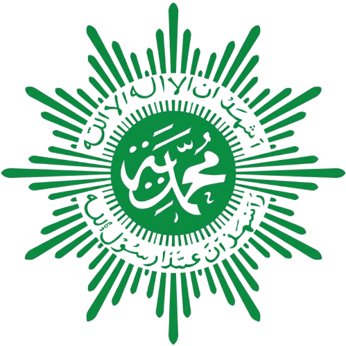
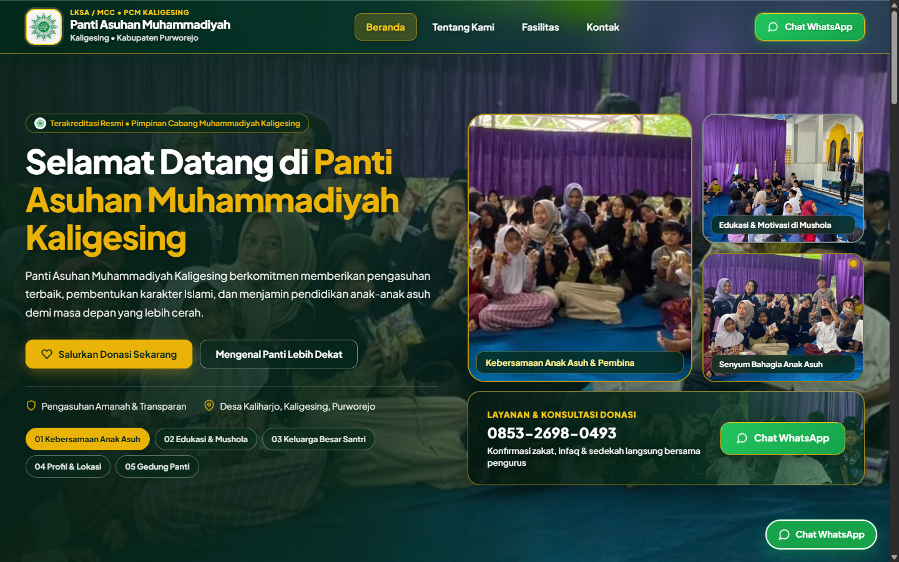
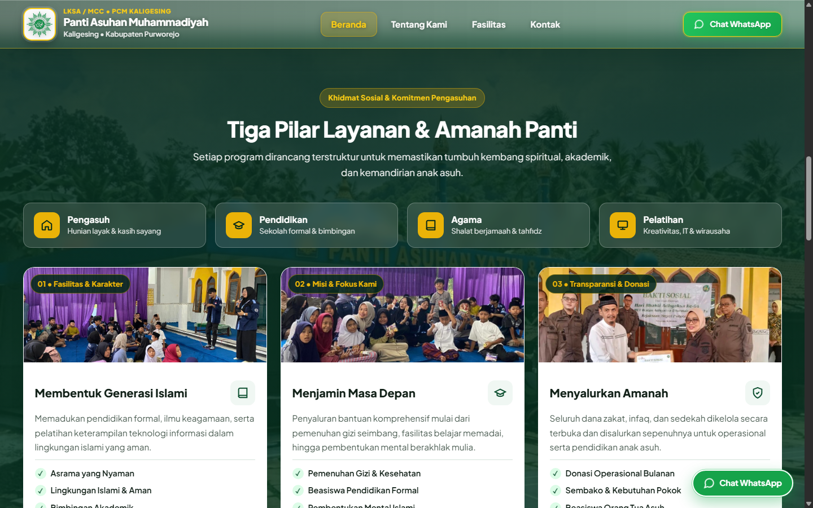
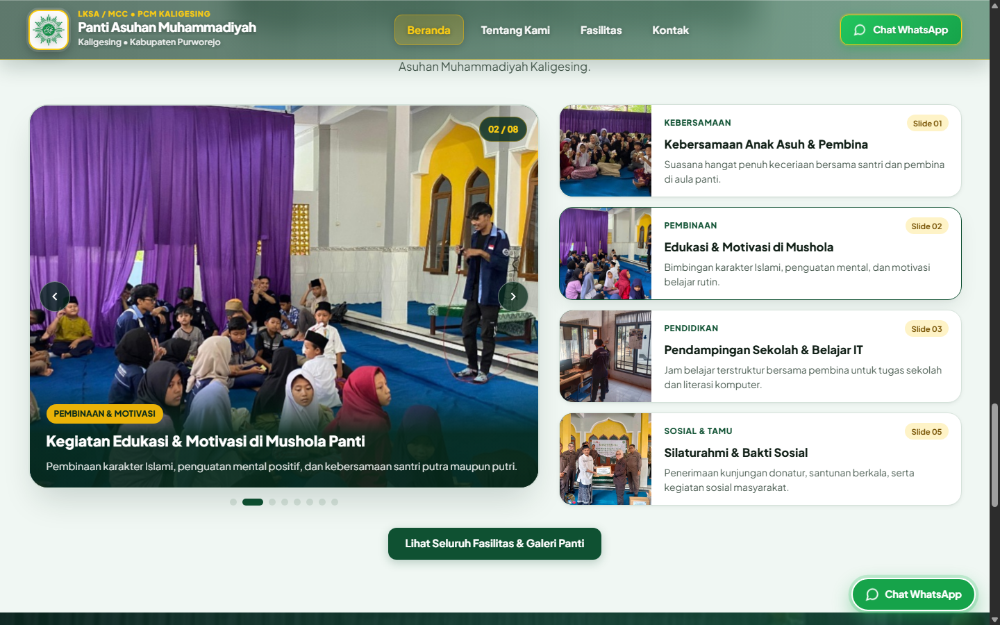
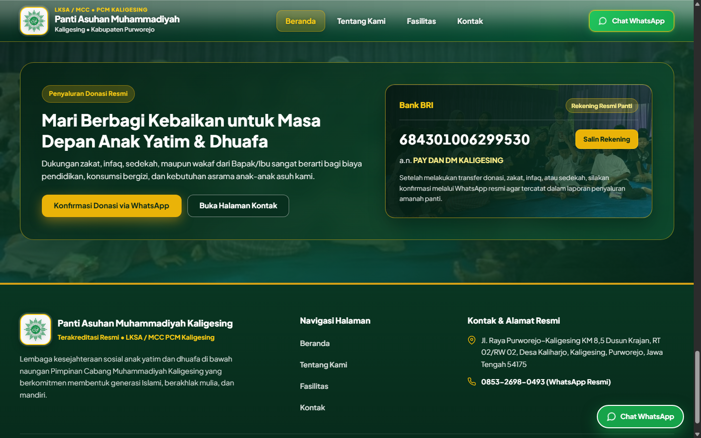
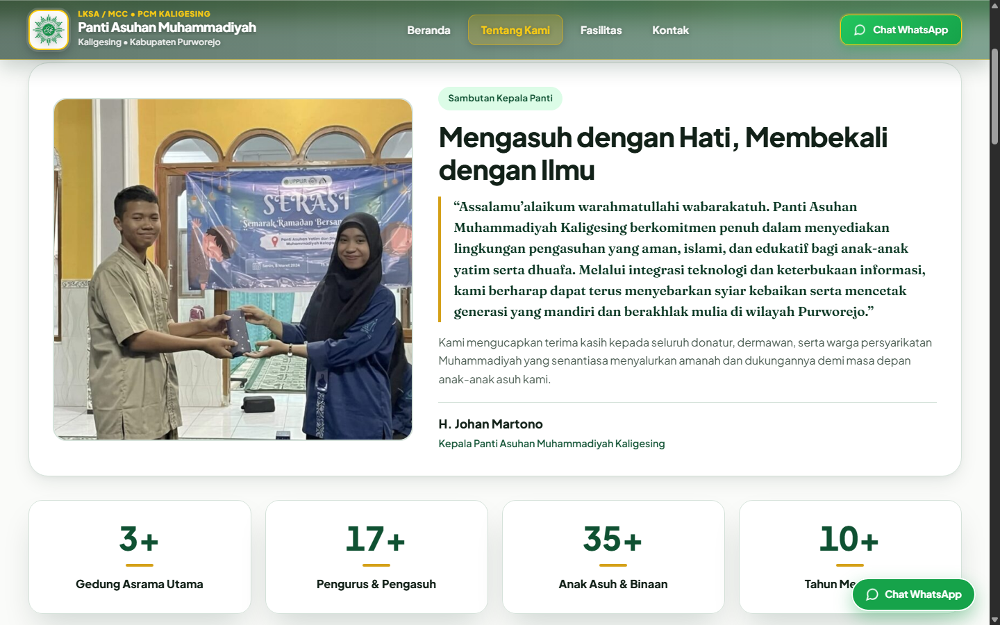
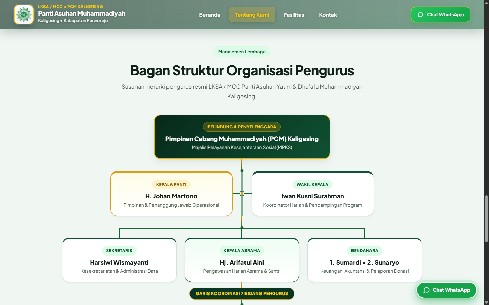
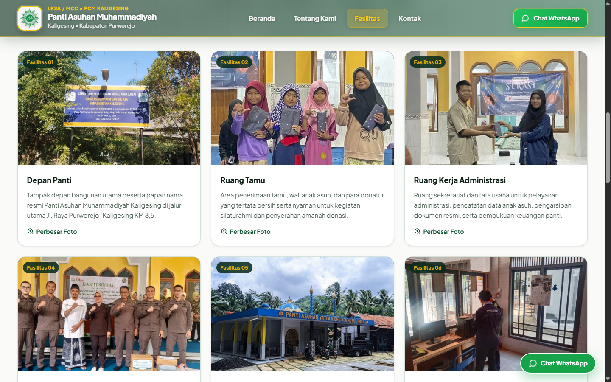
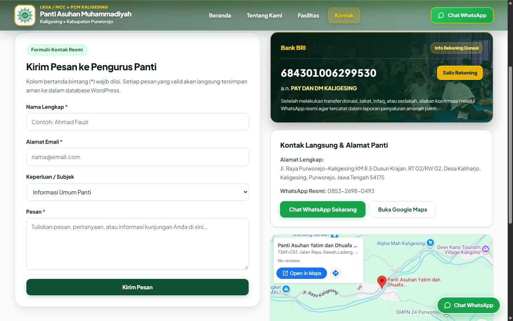
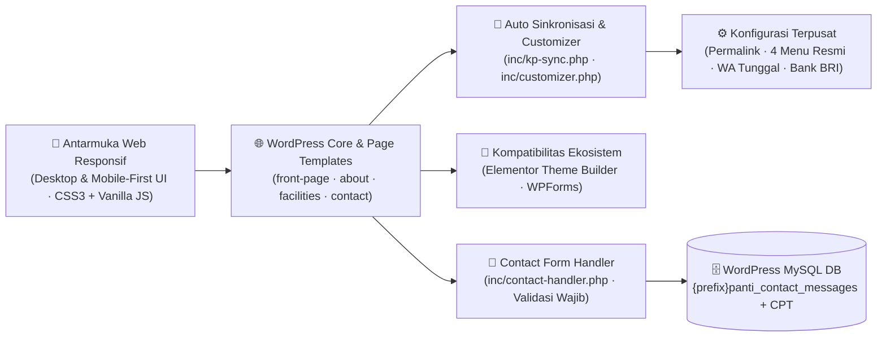

  

  <h1>Panti Asuhan Muhammadiyah Kaligesing</h1>

  

    <strong>Portal Informasi Resmi &amp; Transparansi Donasi LKSA / MCC PCM Kaligesing</strong> 
    <em>Website WordPress Kustom Beridentitas Muhammadiyah yang Responsif, Amanah, dan Terstruktur — Memuat Profil Lembaga, Bagan Struktur Organisasi, Galeri Fasilitas &amp; Kegiatan Nyata, Info Rekening Donasi Resmi, hingga Formulir Kontak Terintegrasi Basis Data.</em>
  

  

    
    
    
    
    
    
    
    
  

  

    🌐 <strong>Alamat Website Resmi (Live Deploy):</strong> <a href="https://pantimuhammadiyahkaligesing.my.id/">https://pantimuhammadiyahkaligesing.my.id/</a>
  

---

  

  <strong>Panti Asuhan Yatim &amp; Dhu&rsquo;afa Muhammadiyah Kaligesing (LKSA / MCC)</strong> dirancang ulang secara menyeluruh dengan tema kustom beridentitas hijau emerald &amp; emas Muhammadiyah — menghadirkan pengalaman telusur yang bersih di desktop maupun ponsel, dokumentasi nyata santri, dan kemudahan penyaluran donasi.

---

## Mengapa Redesain & Tema Kustom Ini Dibangun?

Tema generik sering kali menyisakan teks bawaan yang tidak relevan, tata letak tidak simetris pada layar ponsel, serta alur donasi yang membingungkan pengunjung. Tema kustom **Panti Asuhan Muhammadiyah Kaligesing** dibangun presisi untuk menjawab kebutuhan transparansi publik, kenyamanan donatur, dan standar tata kelola lembaga:

| Keunggulan Utama | Dampak Nyata bagi Pengunjung, Donatur &amp; Lembaga |
| :--- | :--- |
| 🌿 **Identitas Elegan Muhammadiyah &amp; Tipografi Terbaca** | Menggantikan palet neon yang mencolok dengan kombinasi **Hijau Emerald Tua**, putih bersih, dan aksen **Kuning Emas Muhammadiyah** untuk kenyamanan baca di setiap perangkat. |
| 🧭 **Sitemap 4 Halaman Presisi &amp; Permalink Bersih** | Struktur navigasi ringkas berbahasa Indonesia (**Beranda**, **Tentang Kami**, **Fasilitas**, **Kontak**) dengan URL ramah SEO (`/`, `/about/`, `/facilities/`, `/contact/`). |
| 🖼️ **Visual Nyata Asrama, Santri &amp; Aktivitas Panti** | Dilengkapi slideshow banner interaktif, kolase 3 foto berputar otomatis pada beranda, serta galeri fasilitas terstruktur dengan fitur perbesar (*lightbox*) bebas *tiling bug*. |
| 💳 **Alur Donasi Praktis &amp; 1-Klik Salin Rekening BRI** | Menampilkan informasi rekening resmi **Bank BRI (`684301006299530` a.n. PAY DAN DM KALIGESING)** beserta tombol salin instan dan **1 nomor WhatsApp resmi tunggal (`0853-2698-0493`)**. |
| 🏛️ **Bagan Struktur Organisasi Hierarkis Interaktif** | Menampilkan susunan pengurus lengkap mulai dari **PCM Kaligesing (MPKS)**, Pimpinan Inti (**H. Johan Martono**), Pengelola Harian, hingga **7 Bidang Pelaksana**. |
| 📩 **Formulir Kontak Tervalidasi &amp; Tersimpan ke Database** | Mendukung WPForms maupun handler tema bawaan dengan validasi kolom wajib secara ketat dan penyimpanan pesan langsung ke tabel basis data WordPress. |

---

## Galeri Fitur &amp; Antarmuka

### 1. Hero Banner Interaktif &amp; Tiga Pilar Layanan Terpadu

Halaman utama menyambut pengunjung dengan **Background Slideshow** aktivitas anak asuh, **3 Kotak Kolase Berputar** yang dapat diklik, kartu konsultasi donasi langsung via WhatsApp, bento grid informasi lembaga &amp; landasan hadis pengasuhan yatim, hingga penghitung statistik animasi (*Animated Counters*).

<table>
  <tr>
    <td width="50%" valign="top">
      
      
<strong>Hero Banner &amp; Kolase Foto Santri</strong> Navbar kaca hijau transparan, kontrol slide latar 5 adegan, 3 kotak kolase berputar, dan kotak layanan konsultasi donasi.

    </td>
    <td width="50%" valign="top">
      
      
<strong>Tiga Pilar Layanan &amp; Statistik Panti</strong> Strip 4 khidmat sosial, 3 pilar pengasuhan &amp; transparansi berbasis foto nyata, serta animasi hitung capaian panti.

    </td>
  </tr>
</table>

---

### 2. Ringkasan Dokumentasi Kegiatan &amp; Penyaluran Donasi Resmi

Pengunjung dan calon donatur dapat menelusuri dokumentasi kegiatan panti secara interaktif sekaligus menyalurkan zakat, infaq, sedekah, maupun wakaf dengan informasi rekening resmi yang jelas dan mudah dikonfirmasi.

<table>
  <tr>
    <td width="50%" valign="top">
      
      
<strong>Slideshow &amp; Kartu Aktivitas Interaktif</strong> Carousel dokumentasi pembinaan harian, bakti sosial, dan belajar IT yang tersinkron langsung dengan daftar kartu di sisi kanan.

    </td>
    <td width="50%" valign="top">
      
      
<strong>Kartu Donasi &amp; Rekening Resmi Bank BRI</strong> Nomor rekening BRI <code>684301006299530</code> a.n. PAY DAN DM KALIGESING lengkap dengan tombol Salin Rekening dan konfirmasi WhatsApp.

    </td>
  </tr>
</table>

---

### 3. Profil Lengkap Lembaga &amp; Bagan Struktur Organisasi Hierarkis

Halaman **Tentang Kami** memuat profil kelembagaan yang utuh — sambutan Kepala Panti, rekam jejak panti, sejarah singkat, semboyan pengasuhan, **1 Visi &amp; 4 Misi**, **4 Pilar Program**, hingga **Bagan Struktur Organisasi** lengkap dengan garis hierarki yang presisi.

<table>
  <tr>
    <td width="50%" valign="top">
      
      
<strong>Sambutan Kepala Panti &amp; Profil</strong> Sambutan resmi Kepala Panti (H. Johan Martono), animasi statistik profil, sejarah lahirnya LKSA, serta semboyan pengasuhan.

    </td>
    <td width="50%" valign="top">
      
      
<strong>Bagan Struktur Organisasi Hierarkis</strong> Visualisasi garis komando &amp; koordinasi mulai dari PCM Kaligesing, Kepala &amp; Wakil Kepala, Inti, hingga 7 Bidang Pengurus.

    </td>
  </tr>
</table>

---

### 4. Galeri Fasilitas Utama, Formulir Kontak, &amp; Peta Lokasi Terpadu

Halaman **Fasilitas** menyajikan 6 sarana inti beserta galeri aktivitas dalam tata letak grid yang bersih, sementara halaman **Kontak** memadukan formulir pesan tervalidasi, rekening donasi, kontak WhatsApp, dan peta lokasi Purworejo.

<table>
  <tr>
    <td width="50%" valign="top">
      
      
<strong>Fasilitas Utama &amp; Galeri Foto Lightbox</strong> Menampilkan 6 fasilitas utama (Depan Panti, Ruang Tamu, Administrasi, Mushola, Halaman, Asrama/Ruang Belajar) serta galeri dokumentasi.

    </td>
    <td width="50%" valign="top">
      
      
<strong>Formulir Kontak, WhatsApp &amp; Peta Lokasi</strong> Validasi kolom wajib, penyimpanan ke database WordPress, tombol Chat WhatsApp resmi, dan embed peta Desa Kaliharjo, Kaligesing.

    </td>
  </tr>
</table>

---

## Arsitektur Sistem &amp; Tech Stack

  

| Lapisan | Teknologi &amp; Modul | Peran dalam Sistem |
| :--- | :--- | :--- |
| **Platform CMS** | `WordPress`, `PHP 8.x` | Manajemen halaman, customizer tema, permalink `/%postname%/`, serta integrasi *Elementor* &amp; *WPForms* |
| **Template Halaman** | `front-page.php`, `page-about.php`, `page-facilities.php`, `page-contact.php` | Struktur layout khusus untuk Beranda, Tentang Kami, Fasilitas, dan Kontak tanpa ketergantungan template bawaan |
| **Antarmuka &amp; Gaya** | `assets/css/main.css` (`Plus Jakarta Sans` + `Fraunces`) | Palet Muhammadiyah Emerald–Emas, navbar kaca transparan, grid bento, bagan organisasi, dan tata letak adaptif ponsel |
| **Interaktivitas UI** | `assets/js/main.js` (Vanilla JS) | Menu drawer melayang mobile, preloader halus, rotasi kolase, counter animasi, carousel kegiatan, salin rekening, &amp; lightbox galeri |
| **Pengolah Kontak** | `inc/contact-handler.php` | Validasi input wajib sisi klien &amp; server, proteksi *nonce*, serta penyimpanan pesan ke tabel kustom &amp; *Custom Post Type* |
| **Sinkronisasi Terpusat** | `inc/kp-sync.php`, `inc/customizer.php` | Pengaturan 1-klik nomor WhatsApp tunggal, informasi rekening donasi, alamat resmi, serta pembuatan struktur halaman otomatis |

---

## Ringkasan Sitemap &amp; Struktur Halaman Resmi

Seluruh navigasi situs dirancang konsisten untuk memastikan akses informasi publik yang cepat, bersih, dan terpercaya:

| Menu Navigasi | URL Resmi | Konten Utama Halaman |
| :--- | :--- | :--- |
| **Beranda** | `/` | Hero slideshow banner, 3 kotak foto berputar, info WA &amp; alamat, hadis pengasuhan, 3 pilar layanan, statistik animasi, dokumentasi kegiatan, &amp; rekening donasi BRI |
| **Tentang Kami** | `/about/` | Sambutan Kepala Panti (**H. Johan Martono**), statistik lembaga, sejarah singkat, semboyan, **1 Visi &amp; 4 Misi**, **4 Pilar Program**, &amp; Bagan Struktur Organisasi |
| **Fasilitas** | `/facilities/` | Ringkasan sarana utama 01–03, galeri **6 Fasilitas Utama** panti, dan dokumentasi foto aktivitas santri dilengkapi pratinjau ukuran penuh (*lightbox*) |
| **Kontak** | `/contact/` | Formulir kontak standar tervalidasi, info rekening **Bank BRI**, tombol **Chat WhatsApp Resmi (`0853-2698-0493`)**, alamat lengkap Desa Kaliharjo, &amp; Google Maps |

---

  <strong>Panti Asuhan Yatim &amp; Dhu&rsquo;afa Muhammadiyah Kaligesing</strong> — Portal Digital Resmi LKSA / MCC PCM Kaligesing (<a href="https://pantimuhammadiyahkaligesing.my.id/">pantimuhammadiyahkaligesing.my.id</a>) untuk syiar kebaikan, transparansi donasi, dan pengasuhan anak yatim yang amanah.

